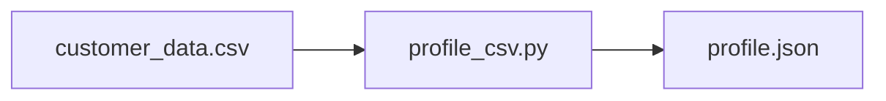

# Smart CSV Profiler

A lightweight command-line profiler for CSV datasets. It detects inferred column types, missing values, duplicate rows, numeric outliers, cardinality, and suspicious string patterns, then writes a machine-readable JSON report.

[Research notes](docs/RESEARCH.md) · [Architecture](docs/ARCHITECTURE.md) · [Execution record](docs/RESULTS.md) · [Project site](docs/index.html)

---

## Research context

How reliably can inexpensive column-level statistics flag dataset issues before downstream processing?

The repository provides an inspectable implementation of **dataset profiling and anomaly screening**. It is an exploratory engineering project; broader effectiveness and practical deployment require further study.

## Implemented capabilities

- CSV shape and duplicate-row summary
- Inferred semantic types: numeric, datetime, boolean, categorical, text
- Missing-value and uniqueness statistics
- IQR-based numeric outlier counts
- Suspicious-value detection for empty-like tokens, URLs, emails, and unusually long strings
- JSON output suitable for CI/data-pipeline checks

## Architecture



The diagram is a simplified view of the supplied implementation. Detailed modules and interface assumptions are in [architecture notes](docs/ARCHITECTURE.md).

## Run locally

**Environment:** Python 3.11+ is the documented baseline. Install optional services or hardware drivers when required. Dependencies: pandas, numpy.

```bash
python -m venv .venv
source .venv/bin/activate       # Windows: .venv\Scripts\activate
python -m pip install -r requirements.txt
```

Run the following commands from the repository root:

```bash
python src/profile_csv.py sample/customer_data.csv --output outputs/profile.json
```

**Input:** `sample/customer_data.csv`

## Results

**Executed locally** with the included input files. This is an implementation check, not an independently validated benchmark.


| Observed field | Value |
|:--|--:|
| Rows | 5 |
| Columns | 5 |
| Duplicate rows | 1 |

**Execution evidence:** [Full command transcript](results/execution.txt) · [Inputs and checksums](results/execution.json)

**Saved outputs**

- [`profile.json`](results/artifacts/profile.json)

The values above come from the bundled fixtures. Model scores, simulated costs, and resource-use estimates should not be interpreted as real-world deployment results.

## Source structure

- [`src/profile_csv.py`](src/profile_csv.py)

Documentation is in [`docs/`](docs/). Bundled inputs remain in their original folders. The original project instructions are archived in [`docs/ORIGINAL_README.md`](docs/ORIGINAL_README.md).

## Limits and next research steps

- Results shown here are from local bundled inputs; they are not published research findings or evidence of external deployment.
- Validate domain assumptions and compare against a documented baseline before making performance or reliability claims.
- Extend testing to larger, independently sourced datasets and report reproducibility, failures and relevant ethical risks.

For the methodology and evaluation design, see [the research brief](docs/RESEARCH.md).

## License

See [`LICENSE`](LICENSE). No affiliation, patent, publication, production deployment or independent endorsement is implied.
